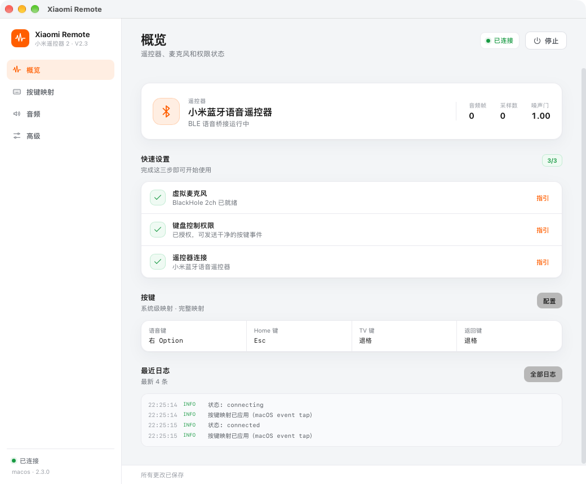
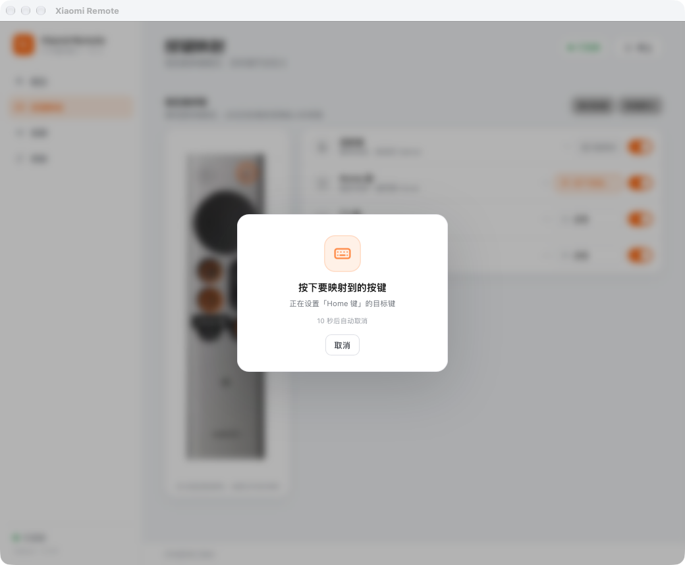
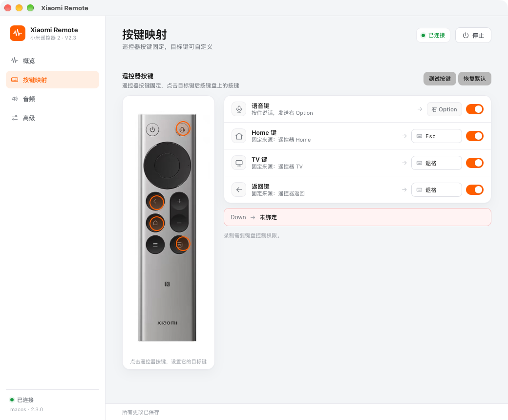

# Xiaomi Remote V2.3

跨平台的「小米遥控器 2」桌面端：BLE ATVV 语音桥接 + 虚拟麦克风 + 设备级按键映射 + 菜单栏 UI。

V2 是 Tauri 2 + Rust 的完整重写，V1 的 Python 脚本仍保留在仓库根目录作为参考实现。



## 快速开始

macOS（需要 Node 20+ / pnpm / Rust）：

```bash
cd v2
pnpm install
./scripts/install-macos.sh
```

首次打开按「概览 → 快速设置」完成三步：安装/选择虚拟麦克风、授权键盘控制、连接遥控器。然后到「按键映射」点击某个按键，按下遥控器上的对应键即可重新绑定。

Linux 使用 `release/` 下的 `.deb`（2.3.0 由 CI/tag 构建），Windows 使用 CI 产出的 NSIS 安装包。

## 功能

- 通过 BLE 连接遥控器，接收 ATVV 语音流
- IMA ADPCM 解码 → 高通 / 平滑 / 自适应噪声门 / 可调增益 → 16 kHz→48 kHz → 虚拟麦克风
- 音频处理可切换：降噪、噪声门、0–18 dB 增益
- 菜单栏常驻：状态、启停、日志、开机自启
- 设备级按键映射：遥控器按键固定，点击目标键后按键盘按键即可重设目标（细节见 [docs/KEY_MAPPING.md](docs/KEY_MAPPING.md)）
- 全新的侧边栏 UI：概览 / 按键映射 / 音频 / 高级，设置更集中、更干净
- 每次语音会话缓存最近一次录音，界面里一键回放
- 按键映射支持「测试按键」：按下遥控器按键即可看到实际目标
- 自动重连、看门狗、单实例、配置持久化





## 平台支持（V2.3.0）

| 能力 | macOS | Windows | Linux |
|---|---|---|---|
| BLE 语音桥接 | ✅ 已实机验证 | ✅ 代码已抽象，待实机验证 | ✅ 代码已抽象，待实机验证 |
| 虚拟麦克风输出 | BlackHole 2ch | VB-CABLE / Virtual Audio Cable | PipeWire / PulseAudio null sink |
| 按键映射 | ✅ `hidutil` + EventTap | ✅ 默认语音键；可选 `interception` feature 提供 Home/TV/返回（需驱动） | ✅ evdev grab + uinput 全键映射（已编译/测试，待实机验证） |
| 菜单栏 / 托盘 | ✅ | ✅ | ✅ |
| 开机自启 | ✅ 已生成并校验 LaunchAgent | ✅（plugin） | ✅（plugin） |
| 录音回放 | ✅ | ✅ | ✅ |

> V2.3.0 首先在 macOS 上跑通；Windows/Linux 的 BLE/音频层使用跨平台 crate（`btleplug` + `cpal`），但还需要在对应系统上做实机验证与按键后端。

## 架构

```text
v2/
├─ src/                     React + TypeScript UI
│  ├─ App.tsx               仪表盘 / 设置 / 日志 / 引导
│  └─ App.css
├─ src-tauri/
│  ├─ src/
│  │  ├─ core/
│  │  │  ├─ adpcm.rs        IMA ADPCM 解码（与 V1 逐样本一致）
│  │  │  ├─ dsp.rs          高通 / 3 点平滑 / 噪声门 / 增益 / 重采样
│  │  │  └─ atvv.rs         ATVV 协议 + 会话状态机
│  │  ├─ ble.rs             btleplug BLE 传输（含 macOS 已连接设备检索）
│  │  ├─ audio.rs           cpal 输出 + 48 kHz 立体声环形缓冲
│  │  ├─ recording.rs       每次会话写 last_session.wav
│  │  ├─ keys/              按键绑定、HID 捕获、macOS hidutil / Linux evdev / Windows 后端
│  │  ├─ state.rs           Tauri 状态 / 命令 / 配置持久化
│  │  └─ lib.rs             托盘、插件、窗口、命令注册
│  └─ tauri.conf.json
└─ package.json
```

数据流：

```text
遥控器 --BLE ATVV--> btleplug --> Session 状态机
                                  ├─ ADPCM 解码
                                  ├─ DSP 链路
                                  └─ CpalSink --> 虚拟麦克风
                                  └─ RecordingSink --> last_session.wav
```

按键链路（macOS）：

```text
点击目标键 → EventTap 捕获下一次键盘按键 → 存为目标 HID usage
遥控器 HID（固定来源） → hidutil UserKeyMapping（按 VID/PID 限定）
           └─ 语音键 → right Option（ATVV 会话期间由 EventTap 吞掉原键）
           └─ Home / TV / 返回 → 用户设置的目标键
```

## 开发

前置：

- Rust 1.85+
- Node.js 20+ / pnpm
- macOS：Xcode Command Line Tools
- Linux：`libwebkit2gtk-4.1-dev`、`libasound2-dev`、`libudev-dev`、`pkg-config`
- Windows：WebView2 Runtime、Visual Studio Build Tools

```bash
cd v2
pnpm install
pnpm tauri dev
```

生产构建与安装：

```bash
pnpm tauri build
./scripts/install-macos.sh --skip-build
# 或者一条命令完成构建 + 安装：
./scripts/install-macos.sh
```

macOS 构建使用 `com.xiaomiremote.app` 做 ad-hoc 签名（`bundle.macOS.signingIdentity = "-"`）。重装/换构建后 TCC 授权可能丢失，需要在系统设置里重新授权一次；如果希望长期稳定，可以改用本地自签名证书：

```bash
./scripts/sign-macos.sh
```

核心测试：

```bash
cd src-tauri
cargo test --lib
```

## macOS 使用

1. 安装 BlackHole 2ch：

   ```bash
   brew install blackhole-2ch
   ```

2. 打开 App，在「概览 → 快速设置」里完成三步：虚拟麦克风、键盘控制权限、遥控器连接。
3. 首次启动会请求蓝牙权限；允许后 App 会自动扫描/连接遥控器。
   为了让语音键变成干净的右 Option、并启用按键录制，需要在「系统设置 → 隐私与安全性 → **Device Control and Data Access**」中允许 Xiaomi Remote（macOS 27 的权限页名称；侧边栏的 Accessibility 是辅助功能*功能*设置，不是这个权限列表）。修改该开关需要输入 macOS 密码。
4. 把系统输入或目标 App 的输入设为 **BlackHole 2ch**（或包含它的聚集设备）。
5. 按语音键说话；界面会显示音频帧和采样数，松开后可以点「播放上次录音」验证。

> 如果之前装过 Karabiner 并启用了遥控器规则，请先退出 Karabiner，避免它和 V2 的 `hidutil` 映射同时作用于同一个设备。

## Windows / Linux 音频路由

### Windows

1. 安装 [VB-CABLE](https://vb-audio.com/Cable/)。
2. App 的音频输出选择 **CABLE Input**。
3. 在目标 App 里把麦克风设为 **CABLE Output**。

### Linux（PipeWire / PulseAudio）

```bash
pactl load-module module-null-sink sink_name=xiaomi_remote \
  sink_properties=device.description="Xiaomi Remote"
```

1. App 的音频输出选择 **Xiaomi Remote**。
2. 在目标 App 里把麦克风设为 **Monitor of Xiaomi Remote**。
3. 语音修饰键需要 `/dev/uinput` 写权限（见上方 udev 规则）。

### Linux 安装包（本地构建）

在 Debian bookworm arm64 容器中已实际构建出安装包：

```text
release/Xiaomi Remote_2.0.0_arm64.deb   (2.0.0 历史包，3.5 MB)
```

安装：

```bash
sudo dpkg -i "Xiaomi Remote_2.0.0_arm64.deb"
sudo apt-get install -f   # 补齐依赖
```

V2.3.0 的 `.deb` / Windows NSIS / macOS DMG 由 tag 发布 workflow 构建；本地 arm64 历史包仍保留在 `release/`。

## 发布

推送 `v2.*` tag 会触发 `.github/workflows/v2-release.yml`，在 macOS / Windows / Ubuntu 上分别构建 `.dmg`、`.exe`（NSIS）和 `.deb`，并附加到 GitHub Release。版本变更见 [CHANGELOG.md](CHANGELOG.md)。

## V1 与 V2 的关系

- V1：`scripts/voice_capture.py` + Karabiner + 手动终端启动
- V2：`v2/` 下的 Tauri App，接管 BLE、音频、按键映射、托盘和自启
- V1 的协议/音频实现是 V2 Rust 移植的参考；`tests/test_voice_capture.py` 仍可用于对照 V1 行为，当前 **14/14 通过**，CI 的 `v1-tests` workflow 会持续验证

## 平台验证

| 平台 | 验证方式 | 结果 |
|---|---|---|
| macOS (arm64) | `cargo test --lib` + `pnpm tauri build` + 实机语音/录音 + 目标键录制 + 测试按键 + 音频处理 | 23/23 测试通过；V2.3.0 已安装运行，快速设置 3/3，`macOS event tap`；Home→F6 目标录制、测试、恢复默认、降噪切换均实测 |
| Linux (Debian bookworm arm64, Rust 1.90, GTK/WebKit 依赖) | 容器内 `cargo test --lib` + Windows 交叉检查 | **25/25** 测试通过；Windows 默认/optional Interception 构建通过 `cargo check` |
| Windows (x86_64-pc-windows-gnu, mingw-w64) | 交叉 `cargo check` + `cargo test --lib --no-run` | 编译并链接成功 |

> Windows/Linux 目前只做了编译与链接验证，尚未在真实设备上验证 BLE/音频链路；macOS 已实机验证。

### macOS 本地自签名证书（可选）

如果每次重新构建后 `Device Control and Data Access` 授权都会丢失，可以创建一个本地自签名代码签名证书，让 TCC 的 designated requirement 保持稳定：

```bash
./scripts/create-dev-cert.sh
# 按脚本最后输出的 codesign 命令给 App 重签
```

这只适合个人使用；分发前仍需 Apple Developer 证书和公证。

## 已知限制

- 遥控器松键后约 0.3–0.5 秒内重按，可能仍会被遥控器自身的 ATVV 冷却挡住；这是目前实测的下限。
- macOS 的语音键 → 右 Option 由 ATVV 会话事件驱动，并用 EventTap 吞掉会话期间的语音键。V2.3.0 已重新授权并显示 `macOS event tap`；重装/换签名后需要在「系统设置 → 隐私与安全性 → Device Control and Data Access」里重新允许 Xiaomi Remote（需要密码解锁）。未授权时会退回 `hidutil` 的 F5+Option。
- 按键录制复用 Accessibility 的 EventTap，不需要额外的 Input Monitoring 权限；目前录制入口只在 macOS 提供，Linux/Windows 使用默认绑定或配置文件。
- Windows 默认只实现语音键（push-to-talk）的 `SendInput` 注入。Home/TV/返回可通过可选的 `interception` feature 启用，但需要安装 Interception 内核驱动，并把 `interception.dll` 放到 exe 同目录：

  ```bash
  pnpm tauri build -- --features interception
  # 或者：cargo build --release --features interception
  ```

  未启用时界面上 Home/TV/返回开关会置灰。
- Linux 已实现完整的 evdev grab + uinput 透传（语音/Home/TV/返回）。运行前需要能读 `/dev/input/event*`（`input` 组）并写 `/dev/uinput`：

  ```bash
  sudo usermod -aG input "$USER"
  # 重新登录后生效
  ```

  ```bash
  sudo tee /etc/udev/rules.d/99-xiaomi-remote.rules <<'RULE'
  KERNEL=="uinput", GROUP="input", MODE="0660", OPTIONS+="static_node=uinput"
  RULE
  sudo udevadm control --reload-rules && sudo udevadm trigger
  ```
- 只保留最近一次录音，缓存为系统 App Data 目录下的 `last_session.wav`；界面只提供回放按钮，不展示路径。
- 按键录制只支持标准键盘 HID usage；遥控器上极特殊的厂商按键可能无法识别，此时会保留原绑定。
